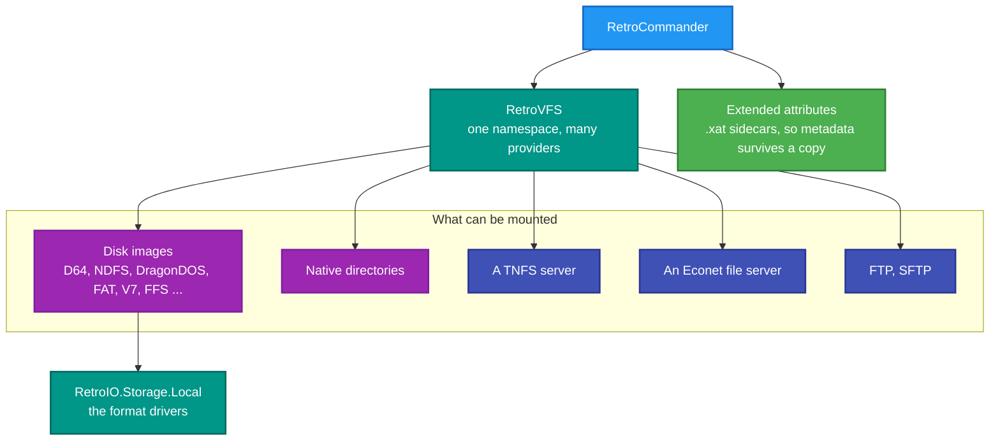
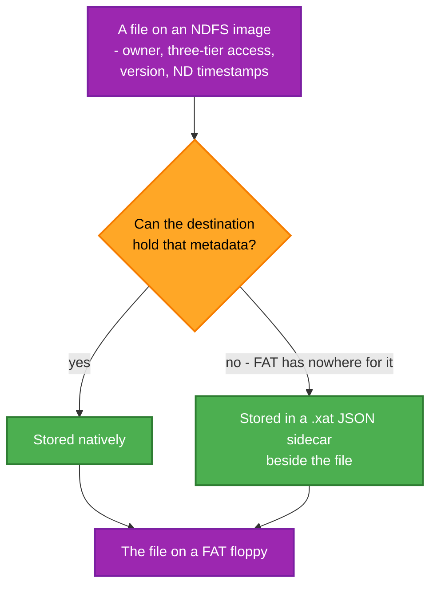

# RetroCommander

**A file manager for vintage disk images.** One window, two panes, and every format RetroIO can read — D64, NDFS,
DragonDOS, FAT, UNIX V7, FFS and the rest — alongside ordinary directories and remote shares.

[](https://github.com/RetroCoreLabs/RetroCommander/actions/workflows/build.yml)
[](https://github.com/RetroCoreLabs/RetroCommander/releases)
[](LICENSE)
[](https://github.com/RetroCoreLabs/RetroCommander/releases)
[What it does](#why-this-repo-exists) · [Prerequisites](#prerequisites) · [The formats](#what-it-sits-on) · [About the disk formats](#about-the-disk-formats)

<!-- A 5-15 second recording: two panes open, a D64 image on one side and a folder on the
     other, a file dragged across. Under 10 MB. Uncomment when the capture exists.

-->
## How this code was written

Some of the code in this repository was written with the help of AI, mostly Claude (Anthropic).
Ronny Hansen directs the work, tests it against real hardware and emulators, and is responsible for
what is in the repository. We say so plainly so you know what you are using.

## Why this repo exists

Getting a file out of a thirty-year-old disk image usually means a format-specific command-line tool, if one exists
at all, and a different one for the next format. Copying a file *between* two formats means both tools and an
intermediate directory.

This is the ordinary answer: mount them all in one namespace and drag. A D64 and a TNFS share and a folder on your
disk are all just volumes, so copying between them is one operation rather than three steps — and the metadata that
the destination filesystem cannot hold is preserved in a sidecar rather than silently dropped.

It is also the most demanding consumer of RetroIO. A file manager touches **every** driver, which makes it the place
a format bug shows up first.

## The application

| Application | What it is | README |
|---|---|---|
| `RetroCommander` | The file manager | [README](src/RetroCommander.Desktop/README.md) |

---

## Status

No tagged release yet, so the release and download badges above are empty until the first
`v*` tag is pushed. The application builds and runs.

- **The solution builds in Release with no errors**, and two test projects cover it.
- **Every driver RetroIO has is reachable** from the two panes, alongside ordinary
  directories and remote shares. A file manager touches all of them, which makes this the
  place a format bug appears first.
- **Metadata the destination filesystem cannot hold is preserved in a sidecar** rather than
  silently dropped.
- **Not yet measured:** copy throughput between formats. No number is claimed here.

---
## Prerequisites

| # | Requirement | Needed for | How to check |
|---|---|---|---|
| P1 | .NET SDK as pinned in `global.json` | Everything | `dotnet --info` |
| P2 | PowerShell 7+ | `build.ps1` | `$PSVersionTable.PSVersion` |
| P3 | **RetroIO packed to the local feed** (`../localfeed`, beside the repositories) | Restore | `dir ..\localfeed` |
| P4 | **A Windows desktop session** | It is an Avalonia GUI | Not usable over a plain SSH session |
| P5 | Disk images to open | Anything useful | `eng\setup-test-data.ps1` in RetroIO creates the junction |
| P6 | The corpus at `Documents\RetroFS\test-images` (under your user profile) | The Dragon and PC images | They exist **only** there |
| P7 | **`RETROFS_DATA_PATH` not set** | Finding the corpus at all | `$env:RETROFS_DATA_PATH` must be empty |
| P8 | A RetroServer, for the TNFS client side | Only the remote tests | `.\build.ps1` in RetroServer |

> **The `RETROFS_DATA_PATH` trap.** That variable relocates the data directory **and** the image corpus. If a
> RetroServer test had you set it, the corpus appears to have vanished here. Clear it first.

```powershell
# from the repository root
.\build.ps1
publish\win-x64\RetroCommander.exe
```

Until the RetroIO packages are on nuget.org they come from the local feed, so **a fresh CI run is red until the
first publish**.

---

## What it sits on



## Copying between filesystems that do not agree



`FileSystemCapabilities` is what answers that question, and the `.xat` sidecar is how the answer "no" stops being
data loss. See `RetroIO.Storage.Core` (`RetroIO/src/RetroIO.Storage.Core/README.md`).

---

## Tests

| Project | Covers |
|---|---|
| `tests/RetroCommander.Desktop.Tests` | The application |

The **drivers** are tested in RetroIO, against real disk images — `src/RetroIO.Storage.Local/tests`. A format bug
found here belongs there as a test, because a driver fixed only in the file manager is a driver still broken for
the servers.

Manual test procedures, including the filesystem matrix, are in
the migration notes, as `Manual tests - RetroCommander.md`.

## About the disk formats

A disk image is a byte-for-byte copy of a floppy or a hard disk, and the bytes mean nothing
until you know the filesystem that wrote them. Between roughly 1975 and 1995 almost every
machine had its own, and they do not resemble each other.

**D64** is a Commodore 64 floppy: 35 tracks, a directory at track 18, and a sector-chain
layout that predates the idea of a file allocation table. **NDFS** is what a Norsk Data
ND-100 minicomputer boots SINTRAN III from. **DragonDOS** belongs to the Dragon 32/64.
**ADFS** is Acorn's, on the BBC Micro and the Archimedes. **UNIX V7** and **FFS** are the
early UNIX filesystems, which is where most of the ideas in a modern one come from. **FAT12,
16 and 32** are the DOS and Windows ones, and the only family still in everyday use.

Getting a file out of one of these usually means a format-specific command-line tool, if one
exists at all, and a different tool for the next format. Copying *between* two formats means
both tools and an intermediate directory. This is the ordinary answer: mount them all in one
namespace, and drag.

---
## Conventions

- Names follow the workspace naming standard; diagrams follow the workspace Mermaid palette. Both live one level
  up in the workspace root, **outside this repository**, so they are paths rather than links: `NAMING.md` and
  `MERMAID_COLOR_STANDARDS.md`.
- `python eng/check-docs.py` checks every link and diagram here.
- The org is **RetroCoreLabs**. `HackerCorpLabs` is retired.

## Contributing

See [CONTRIBUTING.md](CONTRIBUTING.md) for how to get a build running, what the code is
expected to look like, and what will get a change sent back. A security problem goes through
[SECURITY.md](SECURITY.md) and never a public issue.

## Licence

MIT. See [LICENSE](LICENSE).