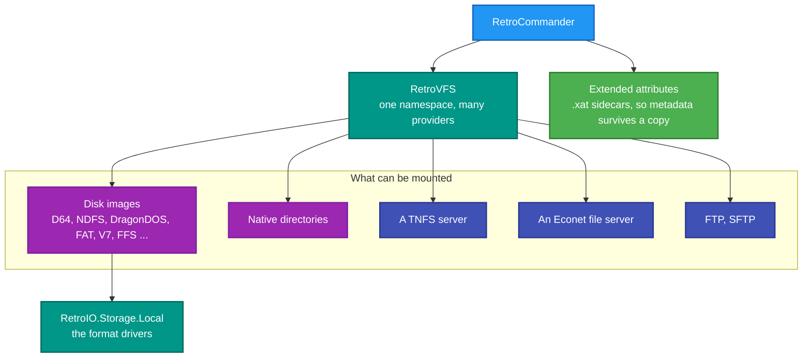
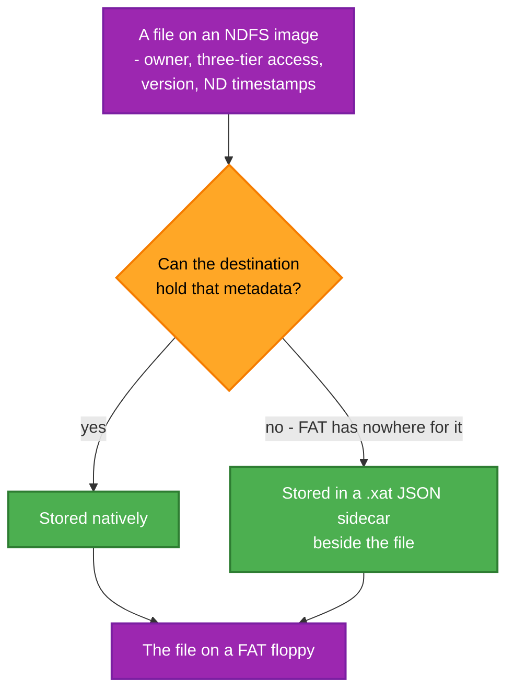

# RetroCommander

**A file manager for vintage disk images.** One window, two panes, and every format RetroIO can read — D64, NDFS,
DragonDOS, FAT, UNIX V7, FFS and the rest — alongside ordinary directories and remote shares.

## Why this repo exists

Getting a file out of a thirty-year-old disk image usually means a format-specific command-line tool, if one exists
at all, and a different one for the next format. Copying a file *between* two formats means both tools and an
intermediate directory.

This is the ordinary answer: mount them all in one namespace and drag. A D64 and a TNFS share and a folder on your
disk are all just volumes, so copying between them is one operation rather than three steps — and the metadata that
the destination filesystem cannot hold is preserved in a sidecar rather than silently dropped.

It is also the most demanding consumer of RetroIO. A file manager touches **every** driver, which makes it the place
a format bug shows up first.

## The application

| Application | What it is | README |
|---|---|---|
| `RetroCommander` | The file manager | [README](src/RetroCommander.Desktop/README.md) |

---

## Prerequisites

| # | Requirement | Needed for | How to check |
|---|---|---|---|
| P1 | .NET SDK as pinned in `global.json` | Everything | `dotnet --info` |
| P2 | PowerShell 7+ | `build.ps1` | `$PSVersionTable.PSVersion` |
| P3 | **RetroIO packed to `E:\Dev\RCL\localfeed`** | Restore | `dir E:\Dev\RCL\localfeed` |
| P4 | **A Windows desktop session** | It is an Avalonia GUI | Not usable over a plain SSH session |
| P5 | Disk images to open | Anything useful | `eng\setup-test-data.ps1` in RetroIO creates the junction |
| P6 | The corpus at `C:\Users\ronny\OneDrive\Documents\RetroFS\test-images` | The Dragon and PC images | They exist **only** there |
| P7 | **`RETROFS_DATA_PATH` not set** | Finding the corpus at all | `$env:RETROFS_DATA_PATH` must be empty |
| P8 | A RetroServer, for the TNFS client side | Only the remote tests | `.\build.ps1` in RetroServer |

> **The `RETROFS_DATA_PATH` trap.** That variable relocates the data directory **and** the image corpus. If a
> RetroServer test had you set it, the corpus appears to have vanished here. Clear it first.

```powershell
cd E:\Dev\RCL\RetroCommander
.\build.ps1
publish\win-x64\RetroCommander.exe
```

Until the RetroIO packages are on nuget.org they come from the local feed, so **a fresh CI run is red until the
first publish**.

---

## What it sits on



## Copying between filesystems that do not agree



`FileSystemCapabilities` is what answers that question, and the `.xat` sidecar is how the answer "no" stops being
data loss. See `RetroIO.Storage.Core` (`RetroIO/src/RetroIO.Storage.Core/README.md`).

---

## Tests

| Project | Covers |
|---|---|
| `tests/RetroCommander.Desktop.Tests` | The application |

The **drivers** are tested in RetroIO, against real disk images — `src/RetroIO.Storage.Local/tests`. A format bug
found here belongs there as a test, because a driver fixed only in the file manager is a driver still broken for
the servers.

Manual test procedures, including the filesystem matrix, are in
`E:\Dev\RCL\Migration\Manual tests - RetroCommander.md`.

## Conventions

- Names follow the workspace naming standard; diagrams follow the workspace Mermaid palette. Both live one level
  up, **outside this repository**, so they are paths rather than links: `E:\Dev\RCL\NAMING.md` and
  `E:\Dev\RCL\MERMAID_COLOR_STANDARDS.md`.
- `python E:\Dev\RCL\eng\check-docs.py .` checks every link and diagram here.
- The org is **RetroCoreLabs**. `HackerCorpLabs` is retired.
