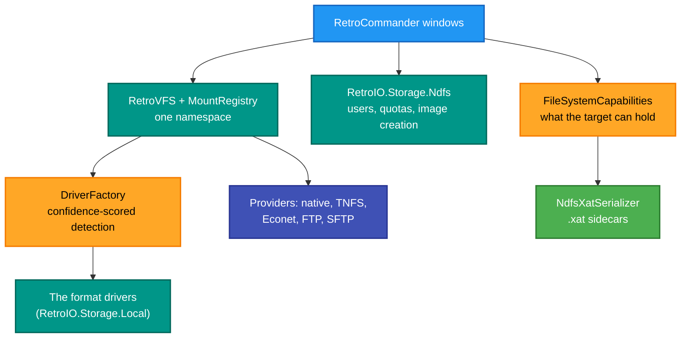
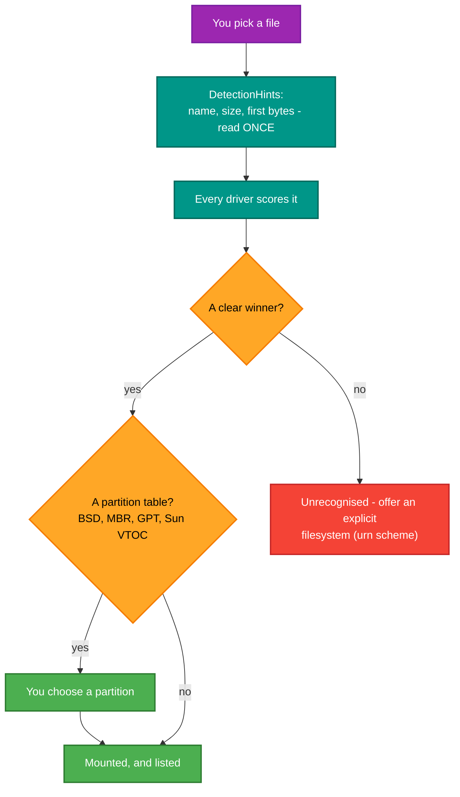

# RetroCommander — the file manager

## What it is

An Avalonia desktop file manager for **vintage disk images and retro filesystems**. Mount a D64, an NDFS system
pack, a DragonDOS VDK, a FAT floppy, a UNIX V7 partition, a TNFS share or an ordinary directory — all in one
namespace — and work with them the way you would work with folders.

## Why you need it

Because the alternative is a different command-line tool per format, and none at all for several of them.

The thing it does that nothing else here does is **copy between formats**. Getting a file from an NDFS pack onto a
FAT floppy image means reading one layout and writing another, and deciding what happens to the metadata the
destination cannot hold. That decision is made properly: a `.xat` JSON sidecar preserves it rather than dropping it.

It is also where NDFS gets a face. Creating an image, inspecting users and quotas, reading the disc information —
all of that exists as library calls and as `ndfs-analyzer`, but seeing a user's quota in a window is how you notice
it is wrong.

## What you can use it for

- **Browsing and extracting** from any format RetroIO reads.
- **Copying between formats**, with metadata preserved in a sidecar when the target cannot hold it natively.
- **Creating blank images** — NDFS and PC — that are valid rather than merely zeroed.
- Inspecting an NDFS pack: disc information, users, quotas.
- Viewing and editing a file in place.
- Mounting a **remote** share — TNFS, Econet, FTP, SFTP — beside a local image.
- Reading file properties, including the filesystem-specific ones.

## Prerequisites

| # | Requirement | Why | How to check |
|---|---|---|---|
| P1 | .NET SDK as pinned in `global.json`, or the published exe | To build or run | `dotnet --info` |
| P2 | **A Windows desktop session** | It is an Avalonia GUI | Not usable over a plain SSH session |
| P3 | RetroIO packed to the local feed | Restore | `dir ..\localfeed` |
| P4 | Images to open | Anything useful | The test corpus, or your own |
| P5 | **`RETROFS_DATA_PATH` not set** | Finding the corpus | `$env:RETROFS_DATA_PATH` must be empty |
| P6 | A copy of anything you will modify | It writes in place | Copy it to a scratch directory first |
| P7 | A running TNFS or Econet server | The remote providers only | Optional |

> **Work on copies.** Editing a file, writing to an image, or repairing one changes the image you opened. The test
> corpus is not a scratch directory.

## The windows and dialogs

| Window / dialog | What it does |
|---|---|
| **Main** | Two panes, navigation sidebar, quick-access bar |
| **Mount** / **Generic Mount** | Mount an image or a provider |
| **New Image** | Create a blank image |
| **Create NDFS Image** | A blank NDFS pack, with initial users |
| **Create PC Image** | A blank FAT floppy or hard disk |
| **Disk Info** | Volume information for any mounted volume |
| **NDFS Disk Info** | The NDFS-specific view |
| **NDFS User Info** | Users, quotas and usage on an NDFS pack |
| **NDFS Info** | NDFS details for a file or volume |
| **Properties** | File properties, including filesystem-specific ones |
| **File Viewer** | Look inside a file |
| **Edit File** | Change it |
| **Settings** | Application settings |

## What it is built on

## Opening an unknown image

Several of these formats are **headerless** — PRG has no signature at all — so detection is scored by confidence
rather than first-match, and "might be" is an honest answer a driver is allowed to give.

> **First-launch caveat:** headless tests cannot catch compiled-binding errors or a missing `avares://` resource.
> Watch for those on the first window after a change.

## Related

- `RetroIO.Storage.Core` (`RetroIO/src/RetroIO.Storage.Core/README.md`) — the VFS, detection and
  capabilities.
- `RetroIO.Storage.Local` (`RetroIO/src/RetroIO.Storage.Local/README.md`) — every format driver, and the
  table of what is supported.
- `RetroIO.Storage.Ndfs` (`RetroIO/src/RetroIO.Storage.Ndfs/README.md`) — NDFS, including image creation.
- `ndfs-analyzer` (`RetroIO/tools/RetroIO.Tools.NdfsAnalyzer/README.md`) — the command-line NDFS analysis
  and repair this app's NDFS windows sit beside.
- Tests: `tests/RetroCommander.Desktop.Tests`.
